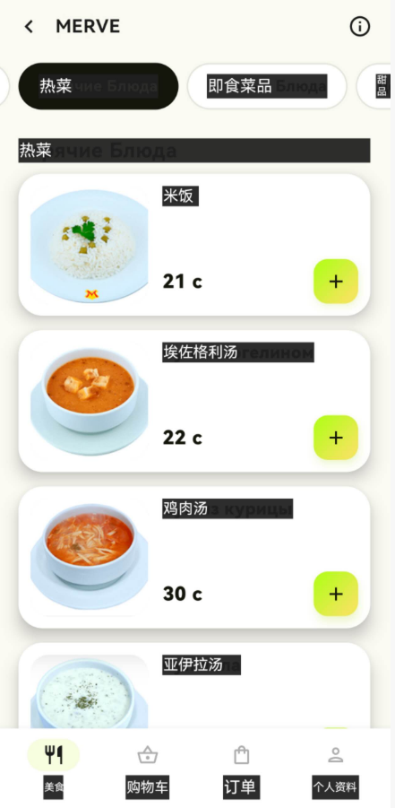
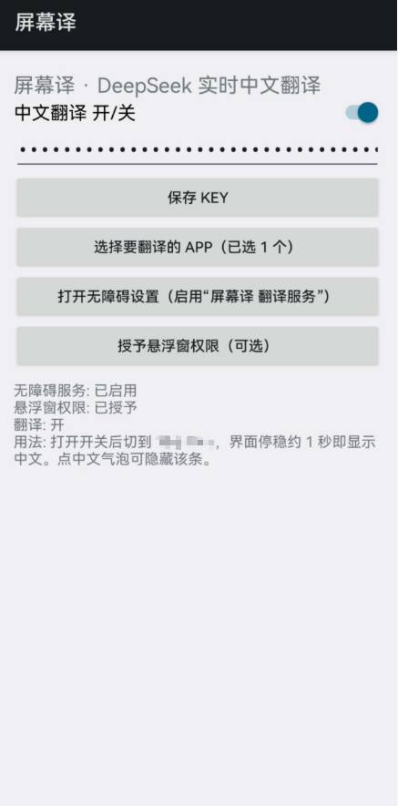

# 屏幕译（Screen Translator）

一个 Android 小工具：用**无障碍服务**读取其他 App 当前屏幕上的文字，调用 **DeepSeek API** 翻译成简体中文，再用一层**透明悬浮层**把中文盖在原文位置上，滑动时中文跟着原文走。

- 包名：`io.github.locker95.screentranslator`
- 当前版本：**v1.6.2**（versionCode 9）
- 最低 Android 8.0（API 26），targetSdk 34
- 纯 Java，无第三方库，不依赖 Gradle
- 许可证：[MIT](LICENSE)

> 最初是为俄语外卖 App **Milli Eats**（包名 `com.zood.mobile`）做的，词典和提示词都针对外卖菜单优化过。白名单里也可以勾选别的 App。

---

## 快速开始

1. 到 [Releases](https://github.com/locker95/screen-translator/releases) 下载最新 APK，装到手机上。
2. 打开「屏幕译」，填入自己的 [DeepSeek API Key](https://platform.deepseek.com/)，点「保存 Key」。
3. 点「打开无障碍设置」，开启「屏幕译 翻译服务」（Android 13+ 可能要先“允许受限设置”，见[下载安装](#下载安装)）。
4. 打开「中文翻译 开/关」，切到要翻译的 App 即可。

## 目录

- [快速开始](#快速开始)
- [简介](#简介)
- [功能](#功能)
- [下载安装](#下载安装)
- [使用](#使用)
- [工作原理 / 架构](#工作原理--架构)
- [从源码构建](#从源码构建)
- [运行测试](#运行测试)
- [更新词典](#更新词典)
- [已知限制](#已知限制)
- [隐私](#隐私)
- [免责声明](#免责声明)
- [许可证](#许可证)
- [版本记录](#版本记录)

---

## 简介

想让一个只有俄语界面的 App 显示中文，常见做法是解包、替换字符串、重新打包。但很多 App 的文字直接写在代码里（例如 Jetpack Compose），或者带有完整性校验、以多个分包分发，改包既麻烦也不稳定，还会动到别人的 App。

屏幕译**完全不修改目标 App**，所以对带完整性校验的应用同样适用。它只“看”屏幕、“盖”一层中文：

- 无障碍服务读取界面上每段文字的内容和屏幕坐标；
- 先查内置词典 / 本地缓存，查不到再批量请求 DeepSeek；
- 用 `TYPE_ACCESSIBILITY_OVERLAY` 类型的全屏悬浮层，在原文的位置画上深色底的中文。悬浮层**不拦截任何触摸**，按钮照常点。

## 截图

<p>
  
  
</p>

## 功能

### 实时跟随的中文悬浮层
- 每条中文的底色框**至少完整盖住原文**，并在四周各多出一点边距（左右 3dp、上下 1dp），这样俄语原文的末尾不会从中文后面露出来。边距会被限制在屏幕范围内；被标题栏 / 标签栏裁切线截断的那一边就停在裁切线上，不会压到固定栏。
- 相邻两条中文的边距会自动收缩，保证不盖住对方的原文（但不会收缩到比自己的原文还小）。
- 中文文字自动缩小（最小 9sp）以塞进底色框，实在放不下就用"…"截断。
- 滑动时有一个约 16ms 一帧的"运动循环"，重新取原文坐标并重绘（见下面的 track / snap 模式）。

### 固定栏识别（顶部栏 / 标签栏 / 底部导航）
- 根据**运动**来判断：页面滚动时，"别的文字都在动、它却纹丝不动"的文字，就被认定为本页面的**固定栏**（chrome），比如标题栏、分类标签、底部导航。
- 由固定栏推出两条**裁切线**：上半屏固定栏的最低边 = 上裁切线；底部 1/4 屏固定栏的最高边 = 下裁切线。还没滚动过时，用顶部 30% 里像标签、标题、可点击按钮的元素做后备估计。
- 位于上半屏或底部 1/4 的固定栏会被扩展成**整屏宽的"禁区带"**（上下各留 4dp）。
- 列表里的中文条（list pill）只要碰到禁区带，或者在裁切线范围内可见的高度不到 70%，就**直接隐藏**。这样列表滚到标题栏、标签栏、状态栏下面时，中文不会叠到固定栏上面。
- 固定栏自己的中文照常显示；如果一个"固定栏"后来又动了，会自动降级回普通列表项。

### track / snap 两种模式（自动选择）
- 滑动时服务会对 3 个列表节点调用 `refresh()` 采样。
- **track（跟踪）模式**：如果 `refresh()` 能拿到实时变化的坐标，就每帧（约 16ms）刷新所有列表节点并重画，中文跟着手指走。
- **snap（快照）模式**：如果拿不到实时坐标（某些 Compose 界面会这样），收到滚动事件的同一帧就先隐藏列表中文（固定栏的中文保留），停止滑动约 100ms 后立刻重新读取并从缓存直接画出来。
- 运动期间大约每 100ms 做一次完整读取。切换页面（窗口 / 根节点类名变化）时会清空状态，重新判断模式。

### 不挡图片
- 只给 `getText()` 有内容、且 `isVisibleToUser()` 的节点画中文。
- 只有 `contentDescription` 的节点（通常是图片、图标）**永远不画**，只把它们的文字拿去预翻译。
- 同一段文字重复出现时（图标描述 + 文字标签、父容器包着同文本的子节点），会去重，只保留一个。

### App 白名单
- 「选择要翻译的 App」页面列出所有带启动图标的 App，可以按名称或包名搜索，勾选后**立即生效**。已勾选的排在最前面。
- 默认只勾选 **Milli Eats（`com.zood.mobile`）**。
- 屏幕译自己和系统界面（`com.android.systemui`）永远不翻译。

### 翻译准确性：词典 + 术语表 + 缓存 + 纠错
- **内置词典** `assets/dict_ru_zh.json`：600 条 Milli Eats 界面和菜单常用文字的俄→中翻译，首次打开即可直接显示，不用等网络。
- **外卖术语表** `assets/glossary_ru_zh.json`（`version: 2`）：
  - `terms`：185 条强制译名（如肯德基式菜名），优先级最高，直接覆盖模型输出；请求 DeepSeek 时，和本批文字相关的术语会附在提示词里，作为"必须使用"的术语表。
  - `fix`：8 条译后纠错规则，格式为 `[俄语词干, 错误译法, 正确译法]`，例如 `баскет`：`篮球 → 桶`、`篮子 → 桶`；`стрипс`：`条带 → 鸡柳`；`твистер`：`扭扭 → 卷饼`。
- **本地持久缓存**：翻译过的文字写入手机上的 `files/cache_g<术语表版本>p3.tsv`，下次直接读取；术语表版本或提示词版本变了，旧缓存会自动删除；超过 20000 行时只保留最新的 10000 条。
- **预翻译**：屏幕外或不可见节点的文字（最多 150 条）也会提前送去翻译，滑到时就已经有中文了。
- 翻译失败的文字会在 15 秒后重试。

### 数字、价格不翻译
- 纯数字、价格、评分、时间、距离、重量等（如 `26 с`、`450 сомони`、`4.7`、`15:23`、`от 30 с`、`★ 4.7`）直接跳过；含数字但字母不超过 3 个的也跳过。
- 提示词里专门说明：`с` / `сом` / `сомони` / `TJS` 是**塔吉克斯坦索莫尼（货币）**，`с` 保持原样，**绝不能译成"秒"**；`мин` = 分钟。
- 已经是中文 / 日文的文字不会再翻译。

### 调试悬浮层（「显示调试信息」）
打开主界面的「显示调试信息」开关后，悬浮层会额外画出：
- **红色框**：固定栏的禁区带，以及上 / 下裁切线（1 像素高的红线）；
- **绿色框**：每条列表中文实际显示的区域；
- **屏幕左侧中间的黄色文字**，格式为：
  `track|snap | read <完整读取平均耗时>ms | chrome <固定栏条数> | cut <上裁切线>-<下裁切线>`

## 下载安装

1. 到 [Releases](https://github.com/locker95/screen-translator/releases) 下载最新的 `screen-translator-v*.apk`。
2. 在手机上点开 APK 安装。系统提示时，允许当前浏览器 / 文件管理器"安装未知来源应用"。
3. 打开「屏幕译」，允许通知权限（Android 13+ 会弹窗询问；开启翻译时通知栏会常驻"屏幕译：中文翻译已开启"）。
4. **填 DeepSeek API Key**：Release 里的 APK **不内置任何 Key**。在 [DeepSeek 开放平台](https://platform.deepseek.com/) 创建 Key，粘贴到「DeepSeek API Key」输入框，点「**保存 Key**」（会提示"已保存"）。
5. **启用无障碍服务**：点「打开无障碍设置（启用"屏幕译 翻译服务"）」，在列表里（一般在"已下载的应用 / 已安装的服务"下）找到「**屏幕译 翻译服务**」，打开并确认。
   - **Android 13 及以上**如果开关是灰的、提示"受限设置"：到 系统设置 → 应用 → 屏幕译 → 右上角 ⋮ → **允许受限设置**，验证身份后，再回无障碍设置打开。不同品牌手机的菜单名称可能略有差异。
6. 「授予悬浮窗权限（可选）」一般**不需要**，无障碍悬浮层不依赖它。

> **从 v1.6（`com.sara.screentranslator`）升级**：从 v1.6.1 起包名改成了 `io.github.locker95.screentranslator`，Android 会把它当成一个新 App。请先**卸载旧版「屏幕译」**，再安装新版，并重新填 Key、重新开无障碍服务。v1.6.1 及以后的版本之间可以直接覆盖升级。

## 使用

1. 打开「屏幕译」，打开「**中文翻译 开/关**」。
2. 点「**选择要翻译的 App（已选 N 个）**」，确认要翻译的 App 已勾选（默认只有 Milli Eats）。
3. 切到 Milli Eats（或其他已勾选的 App），中文会直接盖在原文上：词典或缓存里有的文字马上显示，没有的会在请求 DeepSeek 返回后出现。
4. 正常滑动、点击即可，悬浮层不拦截触摸。
5. 不用时回到「屏幕译」关掉「中文翻译 开/关」，悬浮层和通知会一起移除。
6. 遇到位置不对、遮挡等问题时，打开「**显示调试信息**」截图或录屏，方便定位（颜色含义见上文）。
7. 主界面底部会显示状态：无障碍服务是否已启用、悬浮窗权限、翻译开关。如果 Key 没填或请求失败，会弹出"翻译失败: …"提示（报错里的 Key 会被替换成 `***`）。

## 工作原理 / 架构

源码在 `src/io/github/locker95/screentranslator/`。其中 `Filters`、`Motion`、`TransCache` 是纯 Java，不依赖 Android，可以直接在电脑上做单元测试。

```
无障碍事件 ─► TranslatorService ─(walker 线程)─► 完整读取节点树 ─► Motion 判断固定栏/裁切线
                     │                                     │
                     │                          Store/TransCache 查词典+缓存
                     │                                     │ 查不到
                     │                                     ▼
                     │                       DeepSeek（net 线程，批量请求）──► 写缓存，再读一次
                     ▼
               OverlayView（全屏、不可触摸的无障碍悬浮层）画中文
```

### TranslatorService
无障碍服务，配置见 `res/xml/a11y.xml`：监听 `typeWindowContentChanged | typeWindowsChanged | typeWindowStateChanged | typeViewScrolled`，`notificationTimeout=16`，可读取窗口内容，**只读，不执行任何点击或输入**。
- 开启翻译时启动前台服务通知，并添加 `TYPE_ACCESSIBILITY_OVERLAY` 全屏悬浮层（`FLAG_NOT_TOUCHABLE | FLAG_NOT_FOCUSABLE`，支持刘海区域）。
- 事件来自不在白名单的包时清空悬浮层；窗口切换（`TYPE_WINDOW_STATE_CHANGED` 或换了 App）时清空后重新读取。
- **完整读取**（`fullRead`，在 walker 线程）：遍历节点树（深度 ≤ 60，最多 300 条文字），收集可见文字节点和坐标、可能是标签或标题的元素、不可见文字（用于预翻译）；交给 `Motion` 更新固定栏和裁切线；去重；查缓存。查得到的生成跟踪项，查不到的进入待翻译队列。
- **运动循环**（`tick`，约 16ms 一次）：用 3 个列表节点的 `refresh()` 判断走 track 还是 snap；运动中约每 100ms 做一次完整读取；静止 100ms 后结束循环并做最后一次完整读取。
- **请求调度**：待翻译文字去抖 150ms 后打包；第一批只放**前 10 条**（尽快让当前屏幕出中文），其余每 **40 条**一批，依次请求。第一批返回后立刻重读重画；失败的文字 15 秒内不重试。

### OverlayView
全屏 View，负责绘制：
- 每条中文的深色底框（`#F0202020`）和白字，画在 `Pill.box` 里（原文框加边距，由 `Filters.coverBox` / `trimOverlaps` 算出）；
- 用 `StaticLayout` 排版，字号在 9sp 到 16dp 之间，按原框高度自适应，放不下就缩小字号或在末尾加"…"，排版结果有缓存；
- `hideList()`：只隐藏列表中文，保留固定栏中文（snap 模式用）；
- 调试模式下画红框、绿框和黄色状态文字。

### Motion
纯 Java 的运动分类器：
- `key(text, box)`：用"文字 + 左边位置 / 8 + 宽度 / 8"标识一个节点，竖直方向移动后 key 不变；
- `update()`：和上一次读取比较，有节点竖直移动时，位置完全没变的节点记为固定栏；之后又动了的从固定栏中移除；
- `cuts()`：计算上下裁切线（没有固定栏时用顶部 30% 的标签类元素后备估计）；
- `bands()`：把上半屏或底部 1/4 的固定栏扩展成整屏宽禁区带，其他固定栏四周扩 4dp；
- `listPill()`：列表中文最终显示的区域，可见高度不到 70% 或碰到禁区带时返回 null（隐藏）。

### Filters
纯 Java 的过滤和几何工具：
- `want()`：判断一段文字要不要翻译（跳过数字、价格、单位、纯中日文）；
- `dedupe()`：去掉重复文字（优先保留真实文字而不是 contentDescription，优先保留子节点而不是外层容器）；
- `allowedPackage()`：白名单判断（排除自身和系统界面）；
- `shouldDraw()`：只画"可见且有真实文字"的节点；
- `coverBox()`：计算中文底色框，保证至少盖住原文的可见部分，没被裁切的边再加边距，并限制在屏幕内；
- `trimOverlaps()`：收缩边距，让中文条不盖住相邻条目的原文；
- `clipV()` / `intersect()` / `pillBox()` / `maxLines()` 等几何辅助函数。`cuts()`、`clipFrac()`、`clip()` 是早期版本的裁切算法，现在只在测试里使用。

### DeepSeek
`POST https://api.deepseek.com/chat/completions`：
- `model: "deepseek-chat"`，`temperature: 0.1`，`response_format: {"type": "json_object"}`；
- system 提示词：把塔吉克斯坦外卖 App 的俄语界面文字译成简体中文，只返回 `{"translations":[...]}`，条数和顺序必须和输入一致；菜名按国内肯德基、麦当劳、美团、饿了么的叫法翻译，不能用体育等非食物含义（`баскет` = 桶，不是篮球）；品牌和人名保留或音译；数字、价格、占位符原样保留；`с` 是索莫尼，不是秒；译文长度尽量接近原文。后面附上和本批相关的术语表；
- user 消息：`1. 原文1\n2. 原文2\n…`（原文里的换行替换成空格）；
- 兼容模型直接返回 JSON 数组的情况；缺少的条目用原文补齐；连接超时 10s，读取超时 60s。

### TransCache
纯 Java 的翻译缓存（`ConcurrentSkipListMap`）：
- `normalize()`：合并空白、去掉首尾空白和末尾的"…"或"..."；
- `applyGlossary()`：完全匹配 `terms` 时直接用术语表的译法，否则按 `fix` 规则替换错误译法；
- `get()`：先精确匹配，再查术语表；对被截断的长文本（以"…"结尾、至少 8 个字符），用前缀找到完整原文的译文，按比例截取后加"…"；
- `promptGlossary()`：生成附在提示词里的相关术语（只取长度 ≥ 3 的词条）。

### Store
启动时加载 `glossary_ru_zh.json` 和 `dict_ru_zh.json`，再读取手机上的缓存文件 `files/cache_g<version>p3.tsv`（TSV 格式，转义 `\t` 和 `\n`）。新翻译追加写入；超过 20000 行时保留最新的 10000 条；术语表 `version` 或提示词版本 `PROMPT_VER` 变了，会删除旧缓存。

### Prefs
`SharedPreferences("st")`：
- `key`：DeepSeek Key（没填时用编译时写入的 `BuildConfig.KEY`，Release 版为空）；
- `apps`：白名单（默认 `{com.zood.mobile}`）；
- `on`：翻译开关；
- `debug`：调试开关。

修改白名单或调试开关后，服务会立即生效。`allowBackup="false"`，不会被系统备份带走。

### MainActivity
主界面，从上到下依次是：标题「屏幕译 · DeepSeek 实时中文翻译」、「中文翻译 开/关」开关、「DeepSeek API Key」输入框（密码样式）、「保存 Key」、「显示调试信息」开关、「选择要翻译的 App（已选 N 个）」、「打开无障碍设置（启用"屏幕译 翻译服务"）」、「授予悬浮窗权限（可选）」，最下面是状态文字（无障碍服务、悬浮窗权限、翻译开关的状态，以及简短用法说明）。

### AppPickerActivity
白名单页面（标题「选择要翻译的 App」）：后台线程列出所有带启动图标的 App（图标、名称、包名、勾选框），顶部显示「已选 N 个 App（勾选后立即生效）」，带「搜索 App 名称或包名」搜索框。

## 从源码构建

不用 Gradle，`build.sh` 直接调用 SDK 工具：`aapt2 compile/link` → `javac --release 8` → `d8 --min-api 26` → 把 `classes.dex` 加进 APK → `zipalign` → `apksigner sign/verify`。

### 依赖
- JDK 17+
- Android SDK **build-tools**（需要 `aapt2`、`d8`、`zipalign`、`apksigner`）
- Android **platform 34** 的 `android.jar`（API 34+ 均可）
- `python3`

### 环境变量

| 变量 | 作用 | 默认值 |
|---|---|---|
| `JAVA_HOME` | JDK 路径 | `PATH` 里的 `javac` |
| `ANDROID_HOME` / `ANDROID_SDK_ROOT` | SDK 根目录 | — |
| `BUILD_TOOLS` | build-tools 目录 | `$ANDROID_HOME/build-tools/` 下最新版 |
| `ANDROID_JAR` | `android.jar` | `$ANDROID_HOME/platforms/android-*/android.jar` 中最新的 |
| `KEYSTORE` | 签名证书 | `./keystore.jks`，不存在时自动生成 |
| `KEYSTORE_PASS` | 证书库密码 | 用自己的证书时**必填**；自动生成的 `./keystore.jks` 为 `localdebug` |
| `KEY_ALIAS` | 证书别名 | `key` |
| `KEY_PASS` | 私钥密码 | 同 `KEYSTORE_PASS` |
| `OUT` | 输出 APK 路径 | `out/screen-translator.apk` |
| `DEEPSEEK_API_KEY` | 可选，写入 APK | 空 |

找不到工具时，脚本会给出明确的报错并退出。

```bash
# 示例：用标准 Android SDK 构建
export ANDROID_HOME=$HOME/Android/Sdk
sdkmanager "build-tools;34.0.0" "platforms;android-34"
./build.sh                      # 生成 out/screen-translator.apk（用自动生成的本地证书签名）
```

### 签名证书
- 仓库里**不包含**任何签名证书（`.gitignore` 已忽略 `*.jks`、`keystore*`）。
- 第一次构建时，如果 `./keystore.jks` 不存在，会自动生成一个**本地调试证书**（密码 `localdebug`）。用它签名的 APK **不能覆盖安装** Release 里的官方 APK（证书不同），只能先卸载再装。
- 维护者发布正式版时，使用仓库外保存的正式证书：
  ```bash
  KEYSTORE=/path/to/screen-translator.jks KEYSTORE_PASS=... KEY_ALIAS=key ./build.sh
  ```
  同一个证书签名的新版本才能直接覆盖安装旧版本，请妥善备份，一旦丢失就无法再发布可覆盖升级的版本。
- 密码通过环境变量传给 `keytool` 和 `apksigner`（`:env` / `env:` 方式），不会出现在命令行参数里。

### 关于 `DEEPSEEK_API_KEY`
如果构建时设置了 `DEEPSEEK_API_KEY`，它会被写进 `BuildConfig.KEY`，App 在用户没填 Key 时会使用它。**这样的 APK 里含有你的 Key，任何拿到 APK 的人都能提取出来，绝不要公开发布或分享。** 发布用的 APK 必须在**不设置**该变量的情况下构建：

```bash
env -u DEEPSEEK_API_KEY OUT=out/release.apk ./build.sh
# 检查 dex 里没有 Key：
unzip -p out/release.apk classes.dex | grep -a -c -E 'sk-[A-Za-z0-9]{20,}'   # 应输出 0
```

## 运行测试

单元测试在 `test/` 下，只测试纯 Java 的 `Filters`、`Motion`、`TransCache`，不需要 Android SDK，有 JDK 就能跑。在仓库根目录执行：

```bash
mkdir -p build/test-classes
javac -d build/test-classes \
  src/io/github/locker95/screentranslator/{Filters,TransCache,Motion}.java test/*.java
for t in FiltersTest TransCacheTest VisibilityTest WhitelistTest OccluderTest MotionTest CoverTest; do
  echo -n "$t: "; java -cp build/test-classes $t
done
```

每个测试通过时输出 `ALL PASS`，失败时打印 `FAIL …`，退出码等于失败条数。

| 测试 | 内容 |
|---|---|
| `FiltersTest` | 价格、数字、评分不翻译，菜名和按钮要翻译；去重；裁切 |
| `TransCacheTest` | 文本规范化、术语表强制译名、`篮球→桶` 纠错、截断文本的前缀匹配、提示词术语 |
| `VisibilityTest` | 只有 contentDescription 的图片不画；不可见节点不画；可见比例裁切 |
| `WhitelistTest` | 白名单、排除自身和系统界面、空白名单 |
| `OccluderTest` | 标题栏、标签栏、底部导航的裁切线；被遮住的列表项隐藏 |
| `MotionTest` | 滚动时识别固定栏；整屏宽禁区带；后备裁切线；相邻中文条不重叠 |
| `CoverTest` | 中文底色框完整盖住原文并带边距；屏幕边缘截断；裁切线处不外扩；相邻条目收缩边距但不露出原文 |

## 更新词典

`assets/dict_ru_zh.json` 是把 Milli Eats 界面文字预先翻译好的结果。**生成它用的原始俄语文本不在仓库里**（它们是从第三方 App 中提取的内容），维护者把它们放在仓库外的私有目录，默认是和仓库同级的 `../screen-translator-private/`，可以用 `DATA_DIR` 环境变量修改。目录里包括：

| 文件 | 内容 |
|---|---|
| `ru_src.json` | 从目标 App 提取的界面俄语字符串（JSON 数组） |
| `vocab_ru.txt` | 手工补充的菜单、界面词汇，每行一条 |
| `ru_all.json` | 上面两者合并去重（保持顺序） |
| `dict_raw.json` | `tr.py` 输出的原始翻译结果 |

步骤：

```bash
D=${DATA_DIR:-../screen-translator-private}

# 1. 合并原文
python3 -c "import json,sys;D=sys.argv[1];s=json.load(open(D+'/ru_src.json'));v=[l.strip() for l in open(D+'/vocab_ru.txt') if l.strip()];json.dump(list(dict.fromkeys(s+v)),open(D+'/ru_all.json','w'),ensure_ascii=False)" "$D"

# 2. 调用 DeepSeek 批量翻译（每批 40 条，6 个并发，失败重试 3 次，套用术语表和纠错规则）
DEEPSEEK_API_KEY=你的Key DATA_DIR="$D" python3 tr.py      # 输出 $D/dict_raw.json

# 3. 生成内置词典：去掉译文和原文相同的条目，术语表 terms 优先
python3 -c "import json,sys;D=sys.argv[1];r=json.load(open(D+'/dict_raw.json'));g=json.load(open('assets/glossary_ru_zh.json'))['terms'];json.dump({k:g.get(k.lower(),v) for k,v in r.items() if v!=k},open('assets/dict_ru_zh.json','w'),ensure_ascii=False)" "$D"
```

- 只想修正个别菜名时，直接编辑 `assets/glossary_ru_zh.json`：`terms` 的键用**小写俄语**，`fix` 是 `[俄语词干, 错误译法, 正确译法]`。
- 改了术语表后，把其中的 `"version"` 加 1。手机上的旧翻译缓存会在下次启动服务时自动清空，按新规则重新翻译。
- `tr.py` 不会打印 Key，出错时报错信息里的 Key 会被替换成 `***`。

## 已知限制

- **无法做到和原 App 逐帧同步**：悬浮层和目标 App 是两个独立窗口，坐标靠无障碍接口读取。快速滑动时可能有轻微延迟；在 snap 模式下，列表中文会在滑动时暂时隐藏，停下后再出现。
- **图片里的文字不翻译**（例如海报、菜单图片上的字）。只有 contentDescription 的元素也不会盖中文。
- 有些 Compose 或自绘界面暴露给无障碍服务的文字很少，这部分无法翻译。
- 中文较长时会缩小字号或截断，以保证放进原文框（加边距）的范围内。
- **会产生费用**：DeepSeek 按 token 计费。内置词典和本地缓存能大幅减少请求，但新页面、新菜品第一次出现时仍会请求。
- 首次出现、不在词典里的文字要等网络返回才显示中文。
- 目前只在少量设备上实际测过，不同厂商 ROM（无障碍、受限设置、刘海屏）表现可能不同，欢迎反馈。

## 隐私

- DeepSeek Key **只保存在手机本地**（App 私有的 SharedPreferences，`allowBackup=false`），只用于直接请求 `api.deepseek.com`。
- 屏幕译会把**白名单 App 屏幕上的文字**（不包括截图和图片）发给 DeepSeek 翻译。请不要把含有敏感信息的 App 加入白名单。
- 翻译缓存只保存在手机本地（`files/cache_*.tsv`）。
- 没有任何统计、广告或第三方 SDK。无障碍服务只读取界面，不点击、不输入、不注入任何操作。

## 免责声明

- 本项目是**独立的个人项目**，与 Milli Eats、ZoodFood、DeepSeek 或任何其他 App 及其开发者**没有任何关联**，也未获得它们的认可或授权。
- 屏幕译**不修改、不破解、不重新打包**任何其他 App，只通过 Android 官方无障碍接口读取屏幕文字，并在自己的悬浮层里显示译文。
- 使用者需要自行确保使用方式符合目标 App 的服务条款和当地法律法规，并对自己的使用行为负责。
- 文中提到的所有商标、品牌名称和菜品名称都属于其各自的所有者。
- 机器翻译可能有误，尤其是价格、配料、过敏原等信息，请以原文为准。

## 许可证

[MIT License](LICENSE) © 2026 locker95

## 版本记录

- **v1.6.2**（versionCode 9）
  - 修复中文条比俄语原文窄、原文末尾露出来的问题（分类标签、「Горячие Блюда」这类分区标题、长菜名）：中文底色框现在至少盖住整段原文，并多出一点边距。
  - 更新主界面的用法说明，去掉"停稳约 1 秒""点中文气泡可隐藏"等过时说法，也不再写死 App 名称。
  - 新增 `CoverTest` 单元测试。
  - `build.sh`：javac 编译失败时立即报错退出，不会留下旧的 APK。
- **v1.6.1**（versionCode 8）
  - 包名改为 `io.github.locker95.screentranslator`（需要卸载旧版后重新安装）。
  - `build.sh` 的工具路径和签名参数都改为环境变量，可以自动识别 SDK。
  - 签名证书、从第三方 App 提取的原始文本已移出仓库。
  - 新增 MIT 许可证、免责声明和详细 README。
  - 功能与 v1.6 相同。
- **v1.6**：按运动识别固定栏（顶部栏、标签栏、底部导航），用裁切线和禁区带隐藏滑到固定栏下面的列表中文；自动选择 track / snap 模式；固定栏中文在滑动时保留；中文条不超出原文框、互不重叠；新增「显示调试信息」。
- **v1.1 – v1.5**：多轮根据真机截图和录屏的迭代，包括：
  - 滑动时中文跟随原文；
  - 内置 600 条词典和外卖术语表，加上本地持久缓存，做到打开即显示中文；
  - 菜名纠错（如 `баскет` 译成"桶"而不是"篮球"）；
  - 价格、索莫尼不翻译；
  - 不遮挡图片；
  - 列表中文不压到标题栏和状态栏上；
  - 新增 App 白名单（默认 Milli Eats）。
- **v1.0**：第一版。无障碍服务读取屏幕文字，用 DeepSeek 翻译后显示中文悬浮层，页面停稳约 1 秒后显示。
